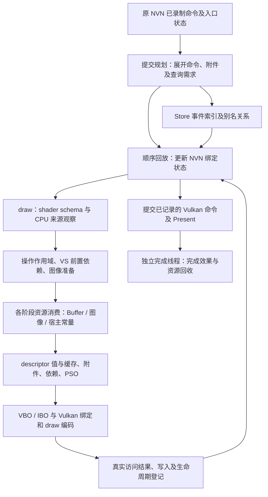

# 从整条翻译路径检查准备工作的复用

以下主体结论来自已有官方工具数据和代码的离线分析，没有修改运行时或增加计时器；为补齐 NVN setter 频度而启动的后续只读检查单列于末尾。源码为 `0f9eb3b`。目标是减少完整准备流程的重复执行，而不是继续给叶子函数加缓存。

结论：高频重复仍然存在，但“次数很多”与“可删除成本很大”必须分别证明。前一图像子集实验已删除约57%的 View 消费访问，Buffer 消费、CPU 来源遍历和最终 descriptor 内容处理仍在执行。下一步应研究持久逻辑资源计划与动态访问记录的分离，不能把扩大图像组当作已经找到数毫秒收益。

## 先明确整条路径

当前提交规划先展开 NVN 指令，计算附件、Store 和 Query 等需求；回放再更新绑定状态并执行 draw。普通 draw 的主要资源流程是：

1. 取得 shader schema，检查 CPU 来源，建立本次 operation。
2. 执行可能产生提交或重入的来源发布、顶点依赖和附件准备。
3. 准备各 stage 的图像，逐 stage 混合消费 Buffer 与图像，生成 descriptor 值。
4. 处理附件及资源依赖，确定实际 Render Pass 和 PSO。
5. 解析 VBO/IBO，编码 Vulkan 绑定与 draw。
6. 发布图像访问历史、Buffer 写入等真实消费结果，结束 operation。

从提交到完成的结构如下。箭头表示执行或结果交付，不表示这些步骤都必须重新计算；图中的复用边界正是本轮要审查的对象。

这张图应按三种粒度阅读：提交级规划、draw 级状态与资源消费、真正发生改变的资源项。现在很多物理对象已经复用，仍然反复执行的是 draw 级的准备与交付外壳。改进应让资源项变化驱动必要准备，而不是仅在每个 draw 的末端查一次缓存。

完成线程的工作不属于这里的翻译线程 Running；Present 的睡眠也不能算进23毫秒回放 CPU 时间。旧同窗拆分中，规划自身为1.456776ms、索引收尾为0.149020ms，两者在 replay self 之外；回放内的 `pass_plan` 约0.306ms只是另一份采样中的查询/游标路径，不能代表整个前置规划成本。

这里混合了三种不同生命周期：逻辑绑定身份、物理资源及其所有权、当前访问的同步状态。Shader 或 Buffer 的动态参数变化，不一定意味着图像身份变化；同一资源身份不变，也不意味着真实 writer、CPU 发布或所有权没有变化。

按职责决定何时重做，比按函数名决定是否缓存更重要：

| 准备产物/职责 | 原则上的更新触发 | 后续消费仍必须做什么 |
| --- | --- | --- |
| shader的资源使用schema | shader/变体创建或切换 | 使用当前schema；不重新反射 |
| NVN槽到逻辑资源的映射 | 实际槽值变化、注册身份变化、完整状态恢复 | 当前shader使用哪些槽；不能把所有已绑定槽算作活跃 |
| Buffer范围到物理backing | 地址/长度变化、Pool关闭/替换或物理迁移 | 新范围的访问证明，动态偏移的正确交付 |
| 图像的物理表示、View及布局 | 格式/用途/子资源/布局/别名生产者变化 | 真正的访问依赖；同View不等于内容不变 |
| CPU来源观察 | 有CPU发布或仍需观察的来源 | 保留真实需求触发；native身份不能替代CPU效果顺序 |
| 当前recording的范围/阶段账本 | 首次消费、新范围/阶段、writer或recording变化 | 已覆盖且无变化才可复用；新recording重新登记 |
| operation所有权 | 新借用、内部提交、重入、结束 | 提交前将借用升级为原有保活；不能用逻辑缓存代替引用 |
| descriptor集合与动态offset | 描述值/布局变化；offset按本次值 | 现有集合缓存已复用；稳定准备应发生在查缓存之前 |
| Vulkan draw与查询副作用 | 每条真实draw/查询 | 必须按序执行；资源复用不意味着draw能删除或整段重放 |

首个结构原型只覆盖其中可闭合证明的只读Buffer子集。表中其余职责是审查地图，不代表已经实现跨draw或跨帧复用。

源码已存在的复用不能重复算成新机会：shader consumer schema、View recipe、descriptor history、PSO epoch、native recording/stage ledger、Buffer last-range/single-word 页覆盖、Buffer common-visible 和 operation source-flow 均已实现。

另一个重要修正：当前共享懒导入配置中，`pool_operation_begin(..., lazy_draw=1)` 直接建立空 operation scope，不调用完整 `draw_pool_collect`。因此，源码里有这段收集函数，并不代表当前每个 draw 都执行它。新方案不得把消除它记为收益。

## 当前真实访问次数

下表读取前一实验同一 scheduler 外包络的已有应用计数，按该外包络的 **guest QueueSubmit 数**归一。A 为同 APK 功能关闭，B 为开启；不是精确工具裁剪窗、不是每个函数的计时，也不是跨版本历史捕获计数。

| 每次 guest QueueSubmit 的平均事件数 | A1 关闭 | B1 开启 | A2 关闭 | B2 开启 |
| --- | ---: | ---: | ---: | ---: |
| View 消费缓存命中＋未命中 | 11,337 | 4,862 | 11,337 | 4,847 |
| Buffer Pool 成功地址消费，hit＋slow | 17,301 | 17,281 | 17,301 | 17,301 |
| descriptor 内容命中＋未命中 | 4,790 | 4,786 | 4,790 | 4,790 |
| Store 规划 descriptor bucket 查询 | 12,015 | 11,995 | 12,015 | 12,015 |
| 实际 pipeline prepare 事件 | 2,390 | 2,388 | 2,390 | 2,390 |

View 消费下降约57%，两个对照方向一致。这个结果说明前一实现确实删除了大量访问；不是所有命中都只多做一次检查。但是仍未证明稳定的净 CPU 毫秒或 FPS 收益，不能用次数比例直接换算时间。Pool 慢路径只有约0.052%；descriptor 分配在整个外包络仅数十次调用，继续追这两个尾部没有高收益证据。

计数口径审计也修正了此前“24.6% draw 命中率”的称法：`stream_submits.draws` 在分块提交时累积 `V.draws`，包含 dispatch 等操作且可能遗漏流尾，不能作为精确 graphics draw 分母。`pipeline_prepare` 也只是 prepare 事件，可能重入，不用它替代 draw。命中数、跳过项数及原始比率保留，但不再声称逐 draw 覆盖。

## 重复的是资源，还是仅仅同一个大 Buffer

用既有官方 GFXReconstruct 单帧输出重新整理资源身份。该帧属于历史 `533820e`、frame1049，共2312个 draw；不能视作当前候选的合法命中率。分段键包含实际 Pass/subpass、command buffer 和原分析中保守的硬命令 epoch；shader 变化不自动改变资源身份。

Buffer 动态偏移按完整 set layout 的 binding/array 顺序解码，再加到 descriptor offset。共11741项动态绑定，11628项偏移非零，不能只比较 VkBuffer 句柄。

| 历史帧观测对象 | 槽访问总数 | 各段首次出现身份数之和 | 段内重复身份访问 | 其中同一 draw 内重复 |
| --- | ---: | ---: | ---: | ---: |
| 采样图像 View＋layout＋stage | 10,701 | 2,677 | 8,024 | 22 |
| Buffer 句柄＋有效偏移＋范围＋类型＋stage | 15,731 | 3,995 | 11,736 | 0 |
| Buffer 句柄＋stage，仅物理 backing 身份 | 15,731 | 1,265 | 14,466 | 5,135 |

因此图像有8002次重复来自后续 draw，Buffer 的11736次也全部来自后续 draw。它们不是仅在一个 draw 内将重复槽去重就能消掉的量。第三行还表明：即使 Buffer 范围改变，物理 backing 身份仍经常不变；但这不能授权省略新范围的依赖和页记录。

进一步按该历史提交对应源码及官方 `VkBufferCreateInfo`、内存绑定、host-pointer import 记录区分来源：

| Buffer 来源证据 | 全帧槽访问 | 段内重复有效范围 | 主 Pass 槽访问／重复 |
| --- | ---: | ---: | ---: |
| 宿主 Uniform-only 常量家族 | 3,662 | 2,942 | 2,344／1,706 |
| Pool usage 形状，且实证绑定导入宿主内存 | 12,069 | 8,794 | 6,735／4,680 |

后者涉及10个 VkBuffer，全部同时具有 HOST_ALLOCATION 声明及 `VkBindBufferMemory` 到 `VkImportMemoryHostPointerInfoEXT` 的证据；这些 descriptor 槽没有 temporary/unknown 分类。它证明共享导入 Buffer 仍有很大重复规模，也排除了把宿主常量的2942次重复错算给 Pool 路径。仍不能从 Vulkan 句柄推断当前 guest Pool 身份或实际 `pool_address` 调用次数；texel BufferView、VBO/IBO未包含在这张表里。

独立复核使用已有官方 SPIRV-Cross/spirv-dis 数据：72个 graphics module 未发现 storage writer，全部10701图像项都出现在对应反射接口。排除同 VkImage 的 framebuffer 附件后，仍有10683项访问、8017次段内重复。主 Pass 为607 draw、9109项采样访问、6652次段内重复，没有同 VkImage 附件重叠。

这些数只回答“重复规模是否值得研究”。CPU 发布、不同 VkImage 的共享内存别名、native 所有权以及当前 shader 实际路径仍需自己的证明。不能将8017或11736称作可以删除的函数调用数，更不能相加后当作本版本已节省操作。

## 结构上的两个主要候选

### 1. 逻辑资源计划持久化，CPU 来源只遍历需要观察的子集

当前 `image_source_plan` 在 operation 开始/结束失效，CPU preflight 每 draw 重新建立槽序列。native 来源最终立即返回，但外层仍先遍历、解析身份、调用。source-flow 已缓存逻辑值，不是每次从零解码；共享 lazy draw 又已经不运行它原来服务的完整 admission 收集。

应把“shader 使用哪些槽、槽当前对应哪个逻辑资源、哪些需要 CPU 来源观察”变成随实际状态变化维护的计划。TEX/IMG、program/schema、注册代数、完整 state restore 等变化时更新；纯 Buffer offset 变化不重建图像部分。未变化时直接沿用计划，只执行确实需要 CPU 观察的条目。

这层只保存逻辑元数据，不缓存像素内容，不借此跳过 GPU alias 或 Pool 所有权。native marker 可以证明不需要 CPU 解排布观察，不能证明内存从不改变。存在 CPU 效果排队、未知来源或回调重入时，仍走原正确路径。

扩展到整段 native 图像消费复用，需要另一个完整合同：实际首次消费后发布访问状态；计划持有 distinct Pool 和物理资源；writer、layout、CPU 发布、外部 owner、关闭/替换及 recording 边界能失效整个相关计划。仅在现有组里取消 `native_entry` 排除，会漏掉所有权问题，不能这样实施。

### 2. Buffer 的身份解析与范围访问分开，按变化更新消费结果

`pool_address` 当前成功命中后仍可能依次执行 mip/图像别名处理、Pool/span 解析、初始化判断、当前 operation 保活和页/stage 记录。它不是一次哈希查找。历史帧中大量有效范围完全相同，当前成功消费仍约1.73万次/guest提交，因此值得研究这整段。

目标是让绑定状态持有已经解析的逻辑范围与物理 backing 关系；范围或物理身份改变时更新这部分。实际访问的可见性、writer 和生命周期单独管理，并在当前 recording 中首次真实消费时登记。只改变偏移时不重新推导没变的 Pool/backing；范围也没变、且访问状态有效时，不再重复整条消费链。

新设计必须从 setter/registry/writer 等变化入口维护状态，不是在每 draw 再建立一张“需要检查的 Buffer 列表”。VBO 地址绑定长度为0、跨 span、可写/未对齐临时副本、内部提交、ghost 重入与资源关闭不能套用普通只读范围合同。已有页覆盖和 native stage ledger 的节省必须扣除，只考察它们外层仍在执行的链条。

## 成本预算与实施顺序

已有同窗官方采样对旧稳定版回放主体给出互斥职责：纹理和附件约6.69ms、Buffer约2.57ms、其余绑定结果构造约1.76ms、操作边界约0.16ms。图像来源预检约1.30ms包含在6.69ms内，不能再相加。整个资源职责约11.18ms；约23ms主体的其他部分包含draw状态、驱动编码和回放等。

这些是职责成本上界，不是可删除预算，而且前一图像组已经改变当前图像链的成本。尤其不能再把旧完整图像预算全部交给下一候选。即使假设消除半数旧资源职责，也仍不足以单独把约26.6ms全翻译降到16.67ms；这个算术只是目标差距，不是收益预测。

本轮优先级：

1. 补齐当前高频消费者的**变化频度和身份分类**，以已有计数/官方捕获为基础，确认 Buffer 有效范围、native/普通图像、来源观察子集分别覆盖多少。Vulkan API 捕获不提供原 NVN Pool 身份，采样次数也不是调用次数；缺口必须明示。
2. 下一实现候选优先选 **Buffer 完整消费计划**，画清“变化入口—计划更新—首次访问—后续消费”的职责。先证明会取消哪些完整循环，扣除新增维护、失效和重建成本，再决定实验范围；尤其先从历史 Buffer 槽计数中分出宿主常量，不能将它们全部归给 `pool_address`。
3. 持久图像来源计划及 native 整组所有权保留为后续结构机会，排在合同和剩余预算明确之后；不同时发起多套缓存实现，也不因身份重复次数大就默认扩大。
4. 分配慢路径、PSO miss、compute 绑定尾项暂不作为主线。也不重新写 descriptor cache 或增加更多页检查。

并行审查还确认一处更上游的机会：前置规划每draw仍枚举活跃shader图像槽并查询逻辑bucket，最新外包络约12015次/guest提交；可研究在实际绑定变化时更新活跃集合，draw仅推进使用位置，并向replay传递逻辑映射。它不能传递GPU-ready或物理保活证明，也不能把未来观察提前执行。完整规划在当前六个官方窗口中为1.38–1.69ms/Surface，包含必须保留的命令校验、查询活性、clear与alias分析。

这与此前 `dc515d0` 的末端事件压缩不同：旧候选已将记录约1.44万压至720，但每draw上游枚举仍执行，未证明规划CPU有稳定净下降。因此不重复实施同一压缩、不按95%记录降幅预报CPU收益；后续必须量化活跃集合真正改变的次数和clear切段次数，再决定是否优先实施。相关条件证明见 `planning-replay-review.md`。

本轮没有新的运行时收益宣称；前一实验仍是工作量减少成立、稳定净 CPU 收益未建立。主线默认源码已包含普通图像子集实现，桌面交付因 Java profile 标签验收缺失已完整回滚，Q735日常包保持旧稳定版；交付回滚结束时已存档并停止。该交付问题已独立收尾，不继续占用结构优化时间。

## 真实 NVN 设置频度补证

为补齐已有 Vulkan 捕获看不到的原 NVN 设置命令，使用官方 LLDB 在当前稳定版 `ec15/10d` 的一次提交规划入口只读保存命令及入口 `vk_state`。共21个句柄、45240条命令、2447个 draw、10个 dispatch。它是一个真实提交的状态快照，不是性能采样，也不推定等于所有场景中的一帧。读取结束后已脱离调试器，经原生命周期确认新存档 `commits=2` 并停止游戏。

| NVN 设置命令 | 记录数 | 值未变的记录数 |
| --- | ---: | ---: |
| UBO 地址/范围 | 7582 | 3433 |
| SSBO 地址/范围 | 114 | 88 |
| Program serial | 2458 | 2048 |
| VBO 地址/声明范围 | 2456 | 583 |
| 纹理 handle 批设置 | 2463 | 1264 |
| Sampler handle 批设置 | 1040 | 1031 |

纹理批命令合计写入36976个槽值，其中32945个与旧值相同；Sampler批命令写入11440个值，其中11389个相同。这些是设置工作量，**不是shader实际使用槽数**。不能将未被当前shader使用的槽算作可跳过的消费，也不能从同地址推断资源内容没有变化。

最有判别力的是同一阶段内部的变化差异：FS UBO槽1设置1561次，仅15次值变化；槽4设置2166次，全部变化。在2031个同program、同保守命令阶段的相邻draw间隔里，槽1有2030次没有有效值变化，但其中1236次仍收到了同值设置。如果按任一UBO设置就丢弃整个FS的准备结果，稳定槽会被槽4连带失效。因此下一原型必须按槽维护变化，不能只给整个stage加一个valid标志。

相反，VBO在这2031个间隔里只有508次整个绑定向量相同；1250个同program/命令阶段的相邻indexed draw对里，仅148对索引地址、范围和类型完全相同。这支持第一版优先处理稳定的只读shader Buffer，将几何、未知长度和临时对齐副本留在原路径。

首次v2快照尚未连接实际shader消费mask；保守命令阶段也不等于真实Vulkan recording/pass边界。内部回调、ghost恢复、writer与别名变化仍须由运行时代码保证。以下v3补齐使用槽，仍不提供合法跳链比例或净毫秒预测。

### 补齐实际使用槽后，收窄到高频的直接 UBO

已有v2保存了program对象，但134个control地址所在的guest heap页面均未捕获，无法凭地址或serial连接Shader文件。离线排除日志/库存的替代映射后，追加一次有界LLDB只读补缺：保存同次入口状态和命令，以及每个control的0x880字节、serial精确命中的运行时shader schema。v3为45223条命令、2445个录制draw，134份control完整SHA连接已核对设备库存的950链；82份实际shader schema与官方spirv-dis及对应元数据交叉核对。91个program精确命中缓存，2个cold program没有使用碰撞bucket，而是按control完整哈希连接已加载的同key不可变schema。设备仍为原稳定包，没有安装新实现；补采结束后新存档commits=2并停止。

| 按实际shader使用槽统计的录制draw消费机会 | 总数 | 同program/保守命令段内与前draw地址范围相同 |
| --- | ---: | ---: |
| VS guest UBO，kind1 | 4819 | 3184 |
| FS guest UBO，kind1 | 6562 | 4626 |
| guest SSBO，kind2 | 1349 | 1088 |
| guest UBO/SSBO合计 | 12730 | 8898 |

宿主生成Uniform另3910项，image/texel另12032项，没有混入guest Buffer计数。12730个guest项均只读且地址/长度非零。稳定的8898项中，7273项之间没有setter，1625项收到同值setter而没有值变化；不是拿全部16槽估算。比如FS UBO槽4虽然设置频繁，但实际使用仅754项，其中同program/命令段的581个相邻机会全部变化；FS槽1实际使用670项，其中544个相邻机会全部不变。

为减少首版合同复杂度，完整候选先只纳入**kind1 guest UBO**：11381项中的7810个稳定机会足以继续实现。1349项SSBO均具备shader bias支持，源地址不是256对齐；这不是证明设备实际发生bias，因为VkBuffer offset和设备limit不由源地址模数决定。首版直接排除所有SSBO，并在cold原消费成功后核实真正的共享lazy Pool、直接对齐Vk offset和纯几何无别名证明。

以上仍是录制命令按最终schema形成的消费机会，上层zero/bloom省略、内部draw与callback未由离线分析执行，不能冒称运行时已调用或可删除7810次。实际内容改变、writer代数、Pool重新注册、recording及physical pass变化还会降低合法复用覆盖。它支持实现按变化槽更新的完整候选，不支持将7810/11381直接乘旧Buffer时间预报收益。

原型独立、默认关闭：稳定项必须跳过前置require及实际消费链，变化项沿原路径；只读结果与真实访问证明分开；内部提交前升级已有Pool借用，不能跳过所有权。还必须统一mixed descriptor值的归属，避免每draw又复制全部稳定项。若这三个部分不能形成闭合可测试单元，不将局部骨架作为已完成优化。

接口子步骤已在独立分支提交 `1b484529`：顶层VS/FS准备产物持有描述值，图像组借用同一数组，nested/ghost仍用独立数组。不增加逐draw整数组复制/扫描，增加约6KiB静态存储及选择分支。Buffer原消费链、动态offset及bias计算全部保留，因此这一步没有性能收益宣称，未合入主线或部署。

最终同一host测试binary在独立测试目录的五项现有验证均通过，包含真实嵌套ghost/promotion及两种回调位置，Vulkan/CoreSYNC无报错。中途两项full测试因复用已预热的PSO目录而失败；失败输出保留，使用独立空目录后通过，没有修改断言。A→不合格B→A与内部提交的未来组合仍需完整计划验证；源码独立审查不代替这些用例，也不代替Android游戏性能测量。

### 图像也要区分整组稳定与部分槽稳定

对同一v3快照继续连接最终shader采样图像槽，没有新增采集。排除671个texel消费机会、7个潜在替代/局部图像变体后，得到11354个采样图像消费机会。在同shader、同保守命令段的9349个相邻槽对中，8031个NVN图像索引及完整handle相同。这里的条件是同一阶段的shader，不要求另一个阶段的program也相同。

| 稳定形状 | 相邻stage对 | 稳定图像槽消费机会 |
| --- | ---: | ---: |
| 整个图像集合不变 | 1063 | 3880 |
| 部分图像变化，其余稳定 | 346 | 4151 |

两个消费最多的FS分别使用15/16个图像槽，通常只改变3/4个槽。它们各有同样的12个NVN槽持续稳定，合计4980个稳定槽机会。整组不变的1063对中，又有313对的guest Buffer来源发生变化。这说明应把图像与Buffer的失效分开，也不能因一小部分图像改变就重做其余所有槽。

这组数字不能全部算作下一优化的收益：快照来自旧稳定版，主线后来加入的普通图像子集已覆盖其中一部分。NVN索引不变也不证明registry中的texture身份、native类型、物理View、内容或访问状态不变。当前证据不能把4980项分为native/普通，也不能连接到当前合法跳过的调用数。下一图像方案必须先在原冷消费中取得实际资源证明，并扣除已有组的覆盖；不会仅凭这组数再加一层逐draw检查。

### draw之外的回放结构也要纳入

同一v3提交的45223条OP中，2445条是绘制，42496条是绑定/光栅等状态设置，另外包含68次附件目标设置、29次清屏、10次dispatch、16次搬运/更新，以及查询/顺序/事件和命令结构。命令里的BEGIN/END/JUMP不是GPU提交次数；内部subchunk由运行时边界决定，不能由这些OP数推出。

状态设置占记录约94%，但旧官方同窗采样中，状态处理及相关比较仅约0.597ms。非draw回放共约5.040ms，另外分散在flush/提交0.801ms、清屏0.685ms、逐OP规划游标与其他入口0.743ms、回放自身0.503ms、dispatch0.430ms等。这些是历史父职责预算，不能除以本次OP数获得单次耗时。还有约0.568ms没有保留完整回放祖先，不能强行分给某个优化。

因此次数仍是筛选复用机会的必要依据，但还须与父职责成本一起判断：不优先为4万多次轻量setter继续加缓存；优先减少它们造成的下游整段准备重复。连续纯状态段能否共用回放准备是后续结构候选，但需保留查询、观察入口、重入及最早安全提交点。真实clear/copy/dispatch与flush提交不能因数量少或参数相同而删除；已有清屏/Store等优化也不能重复算作新收益。

## 用整条路径判断实验结果

每个候选需同时回答三个问题：从哪里开始省、在哪里仍必须消费、为维护证明新增了什么。以当前UBO候选为例：

| 位置 | 预期变化 | 不应混淆的保留工作 |
| --- | --- | --- |
| NVN绑定更新 | 仅真实改变的槽使相应准备结果失效 | 同值setter仍更新原状态，不能改变命令语义 |
| draw前置VS依赖 | 对已证明的稳定只读UBO跳过原require链 | VBO/IBO、未知或写入范围继续原路径 |
| Buffer消费 | 跳过同一有效范围的别名、Pool/span、保活和访问记录整段重复准备 | 真正的新范围、writer、物理pass或recording变化重新准备 |
| descriptor交付 | 沿用已准备的值，不逐draw复制整组值 | Vulkan要求的当前动态offset前缀仍须完整交付，其他类型消费者照常执行 |
| ownership与提交 | 每stage借用已证明的distinct-Pool前缀，提交前转为现有保活 | 完成线程仍按真实GPU完成释放，不提前回收 |

不能只看Pool命中数下降就宣布成功。对照必须在同APK里确认开关确实生效，同时检查前置require和后段消费是否一起减少；再以原官方CPU采样和调度窗口查看整条回放时间及新增维护成本。若次数降了而时间没有可靠下降，应回到这些父职责检查剩余消费、失效和驱动编码，不能继续把同一份旧预算分配给新缓存。

上述接口阶段之后，完整候选已冻结为独立分支 `78807aa`，完成实际共享 lazy Buffer 的 host 验证及下面的 Android 同包对照；没有合入日常运行版本。

### 完整消费计划的四轮真机结果

候选 APK SHA 为 `9c362d6f64057f98dd454acf94b9105a3e8581121238880b8a05f88e9e44c379`。四轮顺序为 OFF、ON、ON、OFF，两边均开启同一普通图像子集优化，使用相同模块、驱动、固定渲染比例与启动配置。原始 NSO 经统一入口重新生成并验证，设备执行模块与既有验证版本字节相同。没有借此修改游戏 binary 或玩法。

| 轮次 | 消费计划 | 翻译线程 Running ms/Surface | replay self ms/Surface | Surface Hz | Running 加权 CPU MHz | Pool 消费/guest submit |
| --- | --- | ---: | ---: | ---: | ---: | ---: |
| A1 | OFF | 26.8984 | 23.3120 | 30.218 | 1540.7 | 17291.10 |
| B1 | ON | 27.2065 | 23.5242 | 30.308 | 1552.4 | 9286.12 |
| B2 | ON | 35.9963–35.9989 | 30.5080 | 20.658 | 1158.2 | 9280.30 |
| A2 | OFF | 26.9796 | 23.2038 | 30.179 | 1540.1 | 17311.61 |

Pool 消费减少46.30%／46.39%，相应 draw 与 PSO 事件变化均不超过约0.13%。这证明消掉了高频工作，但**没有证明净 CPU 或整帧收益**。Pool 计数按同端点的 guest submit 归一，不是拿 Surface 数替代分母；CPU 时间来自官方调度工具，采样栈来自另一官方窗口，两者不相乘伪造函数毫秒。

B2 未通过严格零未知调度状态资格，原失败日志保留。其未知区间共0.419687ms，在159个 Surface 间隔上最多增加0.002640ms/Surface，表中明确上下界。它同时有明显的频率及核心驻留变化，不能全部归因于候选或温度，也不能删除这轮只展示有利结果。频率接近的 A1/B1 已足以说明本次尚无可靠提速证据。

独立 host 验证覆盖实际共享 lazy 导入、三种动态 offset 模式、像素与所有权断言、GPU writer 后读取、非候选绑定穿插及内部提交/ghost 重入；预期 alias 拒绝单列，不当作正常渲染通过。Android 四轮均检查实际后端开关、执行模块及没有启用抓帧/验证层，结束后由原生命周期存档成功并停止。最终恢复旧稳定日常 APK `ec15c8c…`，核实游戏进程已退出。Mali 与借出的平板未参与。

### 从工作量下降回到整条结构

v1 不是少算了一次哈希：它跨过了前置 VS require 和后续 Pool 消费。但新方案为了证明可复用，又在多个消费入口重复验证同一组 recording、pass、writer、registry、alias 条件。源码及实际 Android ELF 审查表明，在普通双 stage、无回调且两 stage 已热的条件下，每 draw 有9次完整阶段采样，涉及43次 getter 调用；冷成功消费还会追加验证。这是特定路径的静态调用结构，不是运行时调用总量或毫秒测量。

因此下一轮要改变的是**有效性证明的责任分配**：draw 入口建立一次证明，真正改变状态的入口使证明失效；下游使用已经建立的结果。必须先关闭 registry/alias 的跨线程发布、内部提交、writer、mip 及重入的所有失效入口。其他线程不能直接修改翻译线程持有的 ready masks；如果不能证明事件与观察顺序，就保留必要检查。不会仅删除 getter，也不会给每个 getter 再加一层缓存。

同时继续看完整回放父职责，而不是把9次检查当成新的全部问题。旧 Pool 路径本来绝大多数就是快命中，其调用量下降不能自动解释为等比例时间下降。需要并列新四轮的资源、附件、Buffer、描述值、驱动编码与非draw职责，确认还有哪些完整处理段没有被跳过。该独立离线分析与 v2 合同审查并行；在证据补齐前不再将旧约11.18ms资源预算重复分配给下一候选。

### 新样本的整条职责分布与后续优先级

独立分析已将旧 `remaining draw/replay/driver` 三个大桶继续按父职责展开。下表为三次独立 Simpleperf record 窗口，每个样本只计一处；不是按另一 Perfetto 窗口换算出的毫秒。

| 父职责 | A1 OFF（592样本） | B1 ON（615样本） | A2 OFF（610样本） |
| --- | ---: | ---: | ---: |
| 资源来源、视图、附件及访问历史 | 151／25.5% | 159／25.9% | 182／29.8% |
| 非draw规划、命令遍历、提交与实际副作用 | 151／25.5% | 165／26.8% | 146／23.9% |
| PSO、draw状态组装与驱动编码 | 120／20.3% | 102／16.6% | 117／19.2% |
| Buffer解析、依赖、准入及新增计划维护 | 84／14.2% | 71／11.5% | 75／12.3% |
| 其余绑定结果与descriptor处理 | 50／8.4% | 73／11.9% | 54／8.9% |
| 无法恢复父职责 | 36／6.1% | 45／7.3% | 36／5.9% |

B2 的低频及核心驻留变化已保留在四轮结果，不用于此处相近频率比较。A1 record 中还有一次 specialization 扩展；少量样本变化不能单独证明某职责回归。原 OFF Pool 消费约99.948%为命中，slow 约9次/guest submit，ON仍约9次；本次消掉的是命中后的维护，不是成千次分配和上传。

最具体的下一整段机会是**附件表示解析与通道组装**：三轮均有39／39／47个样本，约6.6%／6.3%／7.7%。现在每draw仍从附件准备进入图像解析，再得到range/format/view，组装附件描述、extent和有效管线上下文。已有RenderPass、Framebuffer、View对象缓存不等于这段准备已消失。应先查现有render job持有的结果能否直接交付后续draw，避免另造一套相同缓存；实际读写登记和数据依赖必须保留。该预算包含必要访问，不能宣称全部可删。

已有NVN命令快照中，68次SET_RT对应2445条draw，按保守内容/顺序边界形成48个有draw的段。颜色附件出现1582项，其中1536项是段内后续draw；另外1583项绑定了深度附件，其中1563项重复。深度是否真正纳入pass仍由运行时决定，隐含重入和内部提交也会进一步分段。这些数只证明准备频度，不能当作本版本合法复用命中率。

后续顺序是：先完成UBO证明维护收敛的独立对照；并行关闭附件准备复用的合同与覆盖范围；再研究图像来源—物理表示—最终绑定间的重复身份解析。连续纯setter段合并排在其后，不能因非draw占四分之一就删除真实提交、查询或clear/copy。尚未找到一项能够直接省掉约10ms的单独职责。

### v2：证明维护已收敛，完整时间仍未明显下降

独立冻结版 `3c6381d` 将两stage共用的完整phase验证放到一次draw准入，真实owner变化入口负责失效；保留原重试及提交前保活。外线程Pool注册只发布原子registry，不修改owner的ready。Android实际ELF确认准入有3次外部getter，热路径原有的其余重复phase查询已消除。它没有扩大到SSBO、native image或跨pass复用。

实际共享Buffer的三种offset模式、同draw GPU writer回调、提交与ghost、像素及所有权断言通过；alias负例保留原拒绝行为。完整非共享回归也通过，测试binary与各测试范围分别存档。四轮原生游戏同包对照如下；APK为`824374a0…`，原NSO重新加工并验证，游戏执行字节未变。

| 轮次 | 计划 | 整线程Running ms/Surface | replay self | replay内部子职责 | replay合计 | Surface Hz |
| --- | --- | ---: | ---: | ---: | ---: | ---: |
| A1 | OFF | 26.8066 | 23.2973 | 2.3467 | 25.6440 | 30.347 |
| B1 | ON | 26.8074–26.8114 | 23.0578 | 2.5548 | 25.6125 | 30.224 |
| B2 | ON | 26.9252–26.9612 | 23.1326 | 2.5573 | 25.6899 | 30.226 |
| A2 | OFF | 27.0190 | 23.4576 | 2.3691 | 25.8266 | 30.189 |

Pool成功消费两对分别减少46.49%和46.53%，draw与PSO工作量基本相同。self两对减少约0.24/0.32ms，但内部子职责增加约0.21/0.19ms；整线程首对基本不变，反向只少约0.058–0.094ms，不能称作明显稳定提速。增加的标记对应真实`submission_index_build`及队列提交，不能擅自归到UBO保活展开。B1/B2分别有0.946/8.495ms总未知调度区间，保留严格资格失败及上表最坏上界，未重采或删窗。

本轮也补齐一个整体测量边界：既有稳定PMU窗口的每秒指令事件率，两对下降约3.6%–4.1%；频率与核心驻留并不固定。没有精确PMU同窗完成帧数，因此不能据此报告每帧指令收益，更不能认定governor因为优化主动降频。反过来，也不能仅凭CPU毫秒基本不变就断言实际计算量完全未减。源码减少的工作、硬件事件率、单位帧时间分别保留。

原官方工具快照显示线程为top-app、允许CPU0–7；policy3/7当时频率上限分别为2188.8/2150.4MHz，低于硬件报告的2803.2/3014.4MHz。它是测试时系统策略的证据，不是温控根因或硬件极限的证据；没有修改调频或绑核。

已将完整实现及v2维护收敛合入当前源码（`504a193`、`a598163`、`02a33b6`、`ddcda87`），`dm/`与`scripts/`和实测冻结版完全相同。保留工作量成果，不冒称已达到60fps；启动实验开关仍可显式对照。四轮均完成原生命周期存档并停止，设备恢复日常稳定包。附件实验在独立分支继续，尚未交付：首次host回归发现整draw冷重试重复了前段操作，已保留失败，正在改为只重建必要的准备段，不能把这种未闭合候选合入基础运行。

### 将图像职责与混合访问分开后，收窄下一项预算

对v2四个既有Simpleperf窗口再次逐样本归类，分母609／608／600／608。明确附件、clear、dispatch等先按真实父职责排除；每个样本只进入一个分类。能确认的着色器图像链及其自身维护占12.50%–17.27%，不再沿用前述资源大类的25%–30%作为纹理优化预算。

| 完整父职责 | 四窗样本数 | 整线程采样范围 |
| --- | --- | --- |
| 图像来源逻辑解析 | 17／21／18／10 | 1.64%–3.45% |
| 图像CPU来源观察 | 15／10／15／9 | 1.48%–2.50% |
| 物理图像预准备＋View消费子树 | 46／49／50／43 | 7.07%–8.33% |
| 混合descriptor整set交付 | 35／37／39／33 | 5.43%–6.50% |
| 混合图像依赖（含附件） | 10／13／8／7 | 1.15%–2.14% |
| 混合访问历史（含附件） | 24／17／18／18 | 2.80%–3.94% |

后三行不能全算给采样纹理：descriptor同时交付Buffer，依赖和历史向量也包含附件。物理prepare/View可以处理sampled和storage，采样未记录参数，不能按函数名推断每个输入类型。native/普通图像在公共代码中的组成多数仍未知，只保留调用点越过明确分支后可证明的少量归属。来源计划作用域、现有普通图像组维护和未知分支单独保留在完整报告，未从分母删除。

27ms降到16.7ms需要减少约38%的整线程Running。即使不合理地把所有已归属图像职责、所有混合descriptor／依赖／历史及来源未知外壳免费删除，四窗可见包络也只有23.36%–29.61%。这不是全局数学上界，缺失父栈和未归属PC仍存在；它说明**现有证据不足以承诺只做下一项纹理复用就达到60fps**。上述百分比没有乘独立scheduler窗口冒充函数毫秒。

下一结构单位仍应是同一draw的完整消费产物：来源→Pool/VS依赖→prepare→descriptor→dependency/history。让实际状态变化更新已有产物，并将身份、范围、物理表示及首次消费证明向下交付；不能给每层再套一个valid检查。实际CPU发布、首次可见性、writer、资源保活和recording边界继续履行。普通图像组、UBO计划及descriptor缓存已经省掉的工作不能重复计入候选。

附件表示复用已在独立冻结版`e9c60cb`实现：直接借当前render job/framebuffer已有数组，保留每draw实际access和dependency。初版整draw冷重试重复nofxaa/bloom的错误已改为有界局部重建。完整host ON/OFF、真实共享lazy UBO组合、区域扩大／pass结束／Storage及格式升级／深度角色变化的专项均通过，未放宽原断言。共享UBO专项不证明附件热借用的全部联合失效组合；Android默认OFF同包对照正在进行，不预先声明净收益。

### 附件表示复用：四轮真机完成

冻结源码`e9c60cb`、canonical APK `3ea2afb8…`已在Q735运行原ARM64游戏，四轮均保持image split和UBO计划开启，只改变附件实验开关。原始NSO重新生成并验证，执行/规则字节和98个UI资源不变；相同APK包含重建的加载器库，不声称其字节与前版全部相同。Vulkan驱动、shader与native资源保持原配置。Simpleperf record延长为24秒、99Hz，其他官方窗口仍为8秒；不增加运行时计时器。

| 轮次 | 附件复用 | Running ms/Surface | Surface Hz | Running加权CPU MHz | 附件表示解析残余样本 |
| --- | --- | ---: | ---: | ---: | ---: |
| A1 | OFF | 26.2422–26.2512 | 30.310 | 1538.5 | 39/1811，2.154% |
| B1 | ON | 34.7091 | 21.174 | 1192.7 | 4/1607，0.249% |
| B2 | ON | 26.8941 | 30.180 | 1518.0 | 4/1823，0.219% |
| A2 | OFF | 34.6178 | 21.245 | 1224.3 | 33/1602，2.060% |

两次ON都出现真实recorded draw借用，表示解析采样权重同方向下降；它不是精确调用减少率、热覆盖率或约89%的时间节省。每guest的流记账操作约2395、pipeline prepare约2390、内部提交约7，基本持平；Pool消费反而小幅增加约0.435%/0.236%，不能称此候选减少了Pool工作。

两对整线程差异方向相反：第一对ON多约8.46ms，反向少约7.72ms。OFF和ON各自都有快、慢状态，差异跨replay self、内部规划/提交和外部职责。频率、核心驻留是混杂证据，不归因温度、不做MHz线性校正，也不宣称稳定净收益或可重复回归。A1有2.102292ms总未知状态，严格资格失败，上表保留边界；B1最早stat的变体30→32，后续record/scheduler稳定。首次B1在工具采样前因编排读错日志位置退出，失败、实际命中及存档记录保留；修的是编排，没有删除慢采样窗。

这个实验也定位出进一步的结构缺口：`texture_attachment`已解析image owner/range，返回值却只交付View/format/extent等，后面的`attachment_access`再次调用image_get和range解析。ON的实际access仍有26/35个样本；不能按样本上升认定回归，但源码确有产物丢失。后续应将合法owner/range交付真实access，保留每draw读写和依赖，不能删除访问本身或另建View缓存。

另一个同根缺口是shared-lazy graphics的source计划：lazy admission提前返回，不消费收集列表，后续prepare/View也没有使用这份来源结果。已有source缓存仍有用，不能直接关闭后退回逐draw复制tex_t；下一设计是让来源、物理表示、descriptor和访问共享已有消费产物。native实际覆盖仍缺同次registry→image映射，正在准备最小官方LLDB只读补缺，不把旧相同handle次数当合法跳链覆盖。动态UBO在驱动仍有descriptor复制/偏移修正，但当前整set交付仅5.4%–6.5%样本；BDA/稳定布局需要单独验证实际设备能力与新增GPU代价，不当作已经找到38%收益。

附件受限实现已保留到主线`8e1c46a`，`dm/`和`scripts/`与实测冻结版完全一致；实验开关默认OFF，未扩大到未验证的所有组合。四轮截图无明显黑块或缺场景，不代替全场景正确性；原生命周期存档后停止，已恢复日常稳定APK。Mali和平板未操作，60fps目标尚未达成。

### 附件实验之后：把非 draw 的四分之一继续拆开

对 e9 附件实验的四个既有 Simpleperf 窗口重新按互斥父职责归类，submission planning 加非 draw replay 占24.41%–25.89%。真正的提交、clear、dispatch、copy和query仍保留，不能把这个大类都叫重复工作。规划中的Store读取/附件收集约占3.18%–3.90%；回放的观察器入口、plan游标和外层decode合计约7.43%–8.17%，其中也有必要工作和不能细分的样本。

同版命令快照中，按实际shader schema重建的Store读取槽机会为12047次，其中8427次（69.95%）在同program/stage和保守顺序段内沿用相同逻辑资源；仅复用整个stage则只能覆盖4038次（33.52%）。这说明一个变化槽使整组重做的粒度偏粗。数字是静态逻辑身份机会，不是实际合法命中率；registry变化、footprint/alias与真实访问顺序仍须保留。它不同于此前只把末端事件压缩95%的frontier实验：下一候选必须省掉上游槽枚举和bucket解析，不能再次只压缩输出。

四窗freeze/runtime观察入口36/29/40/26样本、pixel-local入口12/12/12/10、deferred-mip入口7/5/5/4。这些是日常回放的固定入口，不是Profile工具插入的开销；当时freeze/extrap关闭，pixel-local虽开启但未产生计划/绘制，deferred-mip关闭。受限的连续纯状态段有机会一次完成观察器准入和plan交接，逐条原setter及其失效仍执行；活跃观察器、CALL/JUMP、query、clear、真实GPU操作、重入和提交边界继续原路径。独立候选已开始实现，尚无真机净收益。

为连接实际native身份，已执行两次有界官方LLDB只读补采，均因读取编排的错误假设失败，不能当作覆盖证据：v1错误要求texture_limit不大于已分配capacity，实际二者独立；v2错误要求整个Android mutex全零，实际手机libc在normal unlock后保留额外诊断字节。原失败、detach成功、原生命周期存档两次提交、停机与工具清理均保留。当前设备libc与历史已验证文件SHA一致，官方反汇编确认应检查低16位真实state，而不能把其后的残留当持锁状态。修复仅涉及工具读取，不改运行时。

v1在native映射失败前已完整读取OP/program/schema。非draw离线分析独立核对764个原始页及哈希、重新展开控制流并核对93个program/82份schema后，才使用这些字段；它不把整个快照改成成功，也不推断物理图像寿命。原始命令字段分析和native资格补缺分别记账。

### 同次native映射补齐：收回对native候选覆盖的乐观预期

v3复用历史已验证的Q735 mutex读取规则，并核对实际手机libc完整SHA，官方LLDB采集成功。原游戏本次45257条OP、519个实际使用descriptor、物理image/native allocation/Pool身份来自同一暂停；registry/writer/recipe epochs及mutex状态前后一致。实际detach成功、原生命周期存档两次提交、停机和恢复稳定APK均已核验，没有为此更改游戏或运行时代码。

| 同次FS采样图像槽使用 | 次数 |
| --- | ---: |
| 总数（排除7个非FS/变体不确定槽） | 11354 |
| 完整native来源，暂停时resident/coherent | 1251 |
| 普通物理图像、带CPU布局来源 | 2158 |
| 普通物理图像、不带CPU布局来源 | 7945 |

同shader及保守命令段中，native相邻同槽身份不变只有231项，整native子集不变88对。1251不能当可省调用次数，暂停resident也不证明未来writer/pass/recording稳定。它说明此前prepare/View约7%–8%的父预算不能全分给native扩展，首要研究方向须据此调整。

7945个普通无layout槽也不是新收益：已有普通图像组在e9四轮相同scheduler外围端点，每guest submit已经跳过6398–6502项，约584–593次成功复用。这里与单次快照不是同窗，不能相减造精确未覆盖数；但数量级已足以要求扣除既有覆盖。当前继续核对普通图像组的资格、失效及空组构建，特别检查少数变化槽是否使其他稳定槽重新准备；不能预设整组失效就是剩余大头。带layout来源、首次消费、实际写入和同步也不能按“相同ID”直接省掉。

### 用次数排除重复立项，再用整线程占比确定优先级

同次 v3 快照的进一步解析排除了一个假设：普通无 CPU 布局图像的相邻稳定槽共有6509项，整个普通子集不变时覆盖的也是6509项。27次普通子集变化没有留下其它稳定成员；最热两个 shader 的12个普通槽已经受既有分组保护，变化的 native／packaged 材质槽并不使这些普通槽失效。不能再以“一个槽变化拖累另外12个槽”为由重做部分分组，也不能把已经跳过的约6400–6500项再算新增收益。

仍有不同的复用机会：在保守命令段内，2158次 packaged 图像槽引用中1922次在此前 draw 已见过同一 descriptor；1251次 native 引用中878次此前已见过。分别有560和641次并非紧邻上一 draw，说明只缓存上一次材质状态会漏掉旧资源再次出现的情况。这些是实际命令的逻辑身份频度，不是运行时已证明可以跳过准备的次数；CPU publication、物理表示、writer、pass/recording及所有权仍可能变化。

高频也不自动等于大成本。四窗图像 prepare＋View 消费的现有父预算只有整线程采样的7.07%–8.33%，里面含首次消费和必要工作，且尚不能全部归属到上述重访。另一方面，回放外围的7.43%–8.17%也包括无法省掉的非状态操作。两个预算来自不同版本和窗口，不相加，不乘其它窗口的23ms冒充精确可省时间。优先级应综合已观察次数、所属完整路径预算和实际可删除职责，而不是只按函数调用总数。

当前先验证已实现的连续纯状态段候选：42355条状态 opcode 可组成2622段，保留所有原 setter，仅减少段内反复观察器准入和计划游标交接。独立冻结版`ad44b85`及canonical APK已完成，原始NSO重新生成并验证；主机合同和原图形回归已通过，Android同包OFF/ON对照开始，尚不报告净收益。另一路研究直接扩充原 physical recipe 的消费产物，使源身份、物理准备、View及依赖履行结果贯穿各层；不能再建相同的资源目录，也不能只省一个getter却增加多层检查。

## 可复核证据

- `.local/logs/translation-structure-reuse-v1/count_structure.py`、`structure-counts.json`：只整理已有官方捕获输出，输入SHA保留。
- 同目录 `independent-review/review.json`：独立offset、反射及附件重叠复核。
- 同目录 `independent-review/buffer-origin-counts.json`：剥离宿主常量后的共享导入 Buffer 身份频度。
- 同目录 `counter-deltas.json`、`parent-budget.json`、`report.md`：当前同包A/B工作量与原互斥父职责预算。
- 同目录 `source-review.md`：源码生命周期/已有优化审查。
- 同目录 `non-draw-structure.md`、`non-draw-structure.json`：整条45223命令的职责计数及非draw父预算，避免只围着资源叶子函数优化。
- 同目录 `planning-replay-review.md`、`planning-current-envelopes.json`：规划与回放的重复职责、已做过的事件压缩、当前完整规划包络。
- `.local/logs/image-buffer-split-device-v1/final-independent-review.md`：原六轮官方性能结果及计数分母勘误。
- `.local/logs/nvn-command-setter-snapshot-v2/setter-analysis.json`、`analyze_setters.py`：原NVN命令/入口状态的离线整理及口径限制。
- `.local/logs/nvn-command-setter-snapshot-v3/used-slot-analysis.json`：完整control与最终schema连接后的真实使用槽频度；包含官方反汇编、输入指纹和局限。
- `.local/logs/nvn-command-setter-snapshot-v3/image-identity-analysis.json`：同一快照中整组/部分图像稳定度，明确尚未证明物理身份与当前优化剩余覆盖。
- `.local/logs/nvn-buffer-consumption-plan-v1/design.md`：完整消费计划的资格、事件、所有权及回退设计。
- `.local/logs/nvn-buffer-consumption-plan-v1/independent-full-review.md`：冻结版独立源码与 host 验证，明确不代替真机性能结论。
- `.local/logs/buffer-consumption-device-v1/final-independent-review.md`、`final-independent-manifest.json`：四轮官方工具结果、B2资格边界及完整证据指纹。
- `.local/logs/buffer-consumption-device-v1/install-baseline.json`：恢复稳定日常 APK 与原模块字节核对记录。
- `.local/logs/buffer-consumption-device-v1/whole-path-after-v1.md`、同名JSON：新样本的互斥父职责、旧大桶展开与未知归属。
- `.local/logs/translation-structure-reuse-v1/attachment-structure-counts.py`、同名JSON：原NVN附件设置与后续draw频度，只整理已有LLDB快照。
- `.local/logs/nvn-buffer-consumption-plan-v2/contract.md`、`independent-contract-review.md`、`android-phase-gate.disasm`：v2事件合同、独审及实测Android ELF检查。
- `.local/logs/buffer-consumption-device-v2/final-independent-review.md`、`final-independent-manifest.json`、`pmu-window-review.json`：v2四轮工具数据、父子职责及PMU测量边界。
- `.local/logs/buffer-consumption-device-v1/attachment-preparation-contract.md`：附件复用依赖与静态覆盖边界，明确已持有结果和缺少的访问证明。
- `.local/logs/image-preparation-cost-v2/report.md`、`attribution.json`及逐窗`assignments.json`：当前图像链和混合职责的互斥分类、未知归属与跨层预算。
- `.local/logs/attachment-job-reuse-v1/independent-review/final-review.md`、`ready.json`：附件候选失效合同与冻结host验证；`android-ready.json`单列canonical APK，不混同host结果。
- `.local/logs/attachment-job-reuse-device-v1/final-independent-review.md`、同名JSON、`final-independent-manifest.json`：四轮官方工具和互斥会计；`root-scene-cleanup-review.json`记录画面、存档、恢复与源码核对。
- `.local/logs/native-image-preparation-plan-v3/review.md`：统一消费产物、未闭合writer/lifetime边界及最小身份覆盖补缺。
- `.local/logs/descriptor-delivery-architecture-v1/report.md`：descriptor表示与驱动重编码的完整路径、历史次数和当前成本，区分实际能力与未实施方案。
- `.local/logs/replay-architecture-after-attachment-v1/report.md`、`attribution.json`、`e9-field-validation.json`：当前非draw互斥父职责、独立完整命令字段验证与变化驱动读取集合机会。
- `.local/logs/native-image-coverage-snapshot-v1/`、`native-image-coverage-snapshot-v2/`：两次未完成native映射的原始失败及存档/停机记录，不作为native覆盖成功证据。
- `.local/logs/native-image-mutex-abi-audit-v1/`：实际手机libc与历史工具证据一致性、官方反汇编和独立ABI审查。
- `.local/logs/native-image-coverage-snapshot-v3/snapshot.json`、`coverage.json`、`root-actual-review.json`：成功的同暂停资源身份映射、静态使用机会及实际存档/恢复验收，非运行时热命中或性能测量。
- `.local/logs/ordinary-image-coverage-v1/review.md`、`coverage.json`：已有普通分组覆盖、空组构建与非紧邻descriptor重访的次数；不将静态机会当运行时净收益。
- `.local/logs/nvn-state-segments-v1/independent-review/ad44b85-addendum.md`、`android-ready.json`、`raw-ready.json`：冻结候选、实际消费标志及APK/ELF/原始NSO来源核对。
